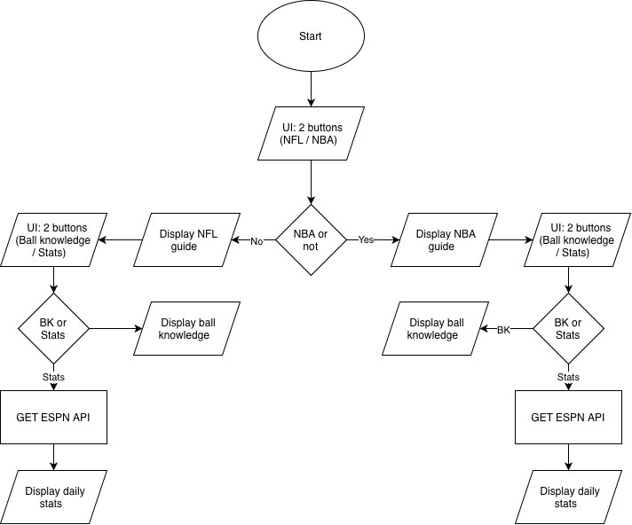

# Sport Larp

An all in one project that allows you to keep up in sports with ultimate "ball knowledge" with your friends

## The Problem

Ever feel like you are left out with your friends when they are talking about sporting events? me too:)) This is a fun project that will help you larp NFL/NBA to your friends at the most basic "ball knowledge" level, higher "ball level knowledge" will be released in sooner updates.

## How It Works



## Tech Stack

- **Language:** Typescript.
- **Libraries:** NextJS, shadcn, Tailwind.
- **External tools:** ESPN API.

## Setup

Step-by-step: TBD

<!-- ```bash
git clone https://github.com/you/your-project
cd your-project
./install.sh   # or whatever
``` -->

<!-- ## Usage

How to actually run the thing, with examples.

```bash
./backup.sh ~/Documents
``` -->

## Roadmap

- [ Version 1.0 ] Build a page explaining how the NFL works, GOATs, and famous events, scandals
- [ Version 1.0 ] Build a page explaining how American football is played
- [ Version 1.0 ] Build a page explaining how the NBA works, GOATs, and famous events, scandals
- [ Version 1.0 ] Build a page explaining how basketball is played
- [ Version 2.0 ] AI model that tells you what to larp about when your friend talks about a certain topic
- [ Version 2.1 ] Advanced AI analysis for larping

<!--  -->

## Author

Phong Ngo, https://github.com/ngotphong
